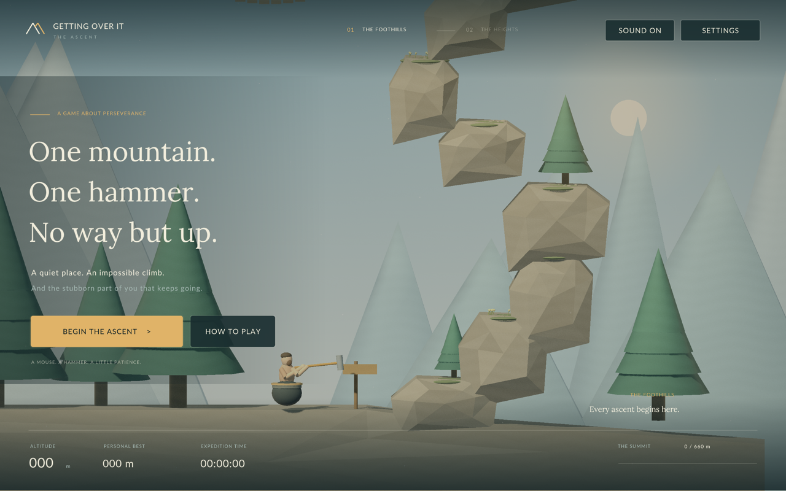

# Getting Over It · The Ascent

A native **C++17** climbing game. One hammer, one cast-iron pot, and a 660-metre alpine mountain. Inspired by the patience and physicality of Getting Over It, with an original procedural environment and presentation.

No JavaScript, TypeScript, Node, npm, browser, or web runtime. Rendering, input, and audio use [raylib 5.5](https://github.com/raysan5/raylib/tree/5.5); shaders are GLSL 330. CMake downloads the pinned, checksum-verified C library on first configuration.



## Build and play

Install a C++ compiler and CMake 3.20 or newer. On macOS, Apple's command line tools provide the compiler (`xcode-select --install`).

```sh
cmake -S . -B build -DCMAKE_BUILD_TYPE=Release
cmake --build build --config Release --parallel
```

On macOS:

```sh
open build/the_ascent.app
```

On Linux: `./build/the_ascent`. On Windows with Visual Studio: `build\Release\the_ascent.exe`.

Linux requires the X11/OpenGL/audio development packages listed in `.github/workflows/build.yml`. macOS and Windows use their native window/audio backends. The first configuration requires Internet access; subsequent builds use CMake's local dependency cache.

## Controls

- **Mouse:** position the hammer. Distance from the climber controls extension.
- **Hold left mouse or Shift:** anchor the hammer when the head touches rock.
- **While anchored:** move toward the anchor to extend and push; move away to retract and pull. Sweep around it to swing. Release to carry momentum.
- **Escape:** pause/resume. **H:** instructions. **R:** restart confirmation.
- **M:** toggle sound. **F11** or **Alt+Enter:** toggle fullscreen.

Progress saves on pause, exit, and every five seconds while resting on a ledge. There are no mid-run respawn checkpoints: falling is part of the climb. The personal best survives a restart; chapter and summit progress track the current ascent separately. Older saves migrate automatically. Saves are versioned, validated before loading, and written via a temporary file.

Save locations: `~/Library/Application Support/TheAscent/ascent.save` on macOS, `%LOCALAPPDATA%/TheAscent/ascent.save` on Windows, and `$XDG_DATA_HOME/the-ascent/ascent.save` (or `~/.local/share/the-ascent/ascent.save`) on Linux.

## What is implemented

- A complete three-chapter mountain with a summit finish and replay flow.
- Fixed 120 Hz simulation, swept hammer contacts, anchoring, momentum, surface collision resolution, and recovery from out-of-bounds falls.
- Procedural 3D terrain, faceted stone, alpine trees, snow, flowers, a suspended bridge, and a waving summit flag.
- PCF-filtered real-time directional shadows, atmospheric distance fog, rim lighting, film grain, vignette, sun glow, altitude-dependent sky, floating seeds/snow, and impact particles.
- An articulated climber and hammer, cinematic title screen, live altitude/time/best HUD, instructions, settings, pause, and restart confirmation.
- Synthesized ambient wind and contact sounds; bundled open-license Lato and Lora fonts.
- Native-resolution Retina rendering, immutable scenery, and a clear save-failure message.
- Native macOS app bundle and portable CMake install layout; CI builds macOS, Linux, and Windows.

## Verification

```sh
ctest --test-dir build -C Release --output-on-failure
```

The physics suite covers surface and embedded collisions, resting stability, hammer anchoring, push-driven ascent, release, bounds recovery, and a 100,000-step stability simulation. It also validates terrain winding, concave notches, exact-edge contacts, invalid inputs, and separate run/lifetime progress. The persistence suite verifies round trips, repeated replacement, invalid write protection, truncated files, version rejection, unsafe values, and migration from version 1 saves. Tests can run without raylib or a window:

```sh
cmake -S . -B build-tests -DASCENT_BUILD_GAME=OFF
cmake --build build-tests
ctest --test-dir build-tests --output-on-failure
```

The executable's `--smoke-test` option opens a window, renders 12 deterministic frames, exports a PNG, and exits without loading or changing saved progress or responding to input. It fails when shader or shadow-framebuffer initialization or image export fails. It supports `--scene=intro|heights|summit|pause|settings|help|victory` and `--capture=/absolute/path.png`.

```sh
bash tests/render_smoke.sh ./build/the_ascent.app/Contents/MacOS/the_ascent /tmp/ascent-render
```

On Linux use `./build/the_ascent` as the executable. CI runs all seven scene captures under Xvfb with software OpenGL and uploads images and logs as an artifact. Native build, physics, persistence, and render checks do not replace full-route playtesting, which remains a release check.

## Source layout

`src/physics.*` and `src/persistence.*` are independent of raylib. `src/world.*` owns procedural rendering resources. `src/main.cpp` owns the game loop, UI, audio, and persistence. `assets/shaders/` contains GLSL. Fonts include their SIL Open Font License files.

References consulted: [original game](https://store.steampowered.com/app/240720/Getting_Over_It_with_Bennett_Foddy/), [raylib CMake guidance](https://github.com/raysan5/raylib/blob/5.5/projects/CMake/CMakeLists.txt), [shadow mapping example](https://github.com/raysan5/raylib/blob/5.5/examples/shaders/shaders_shadowmap.c), and raylib API/examples via Context7. This project is an independent homage and does not use assets from the original game.
